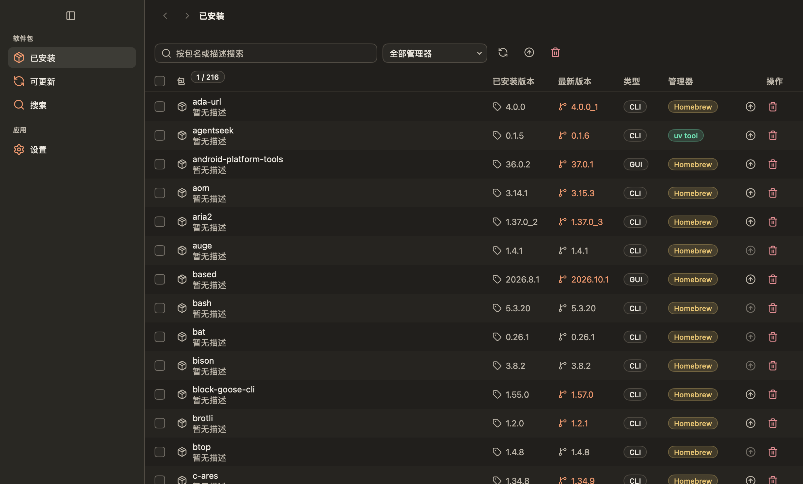

# UniPac

> Status: Work in Process.
> Expect incomplete features, rough edges, and changing APIs.

UniPac is a desktop package manager dashboard written in Go. Its windows are
drawn natively by [MyGo](https://github.com/egoist/mygo) and its controls come
from [Onevra](https://github.com/oneo-me/onevra), so the app ships as a single Go
binary with no webview and no JavaScript.

The goal is to provide one place to inspect and operate on packages installed through different package managers, without making users known about each manager's command-line details.




## What It Does

UniPac is currently focused on:

- Discovering available package managers on the host machine.
- Listing installed packages through backend adapters.
- Caching installed package snapshots in SQLite.
- Showing installed and outdated package views in a native desktop UI.
- Exposing package-manager capabilities so the UI can enable only supported actions.
- Gradually adding search, install, uninstall, update, and version lookup workflows.

## Package Manager Support

The backend is adapter-based. Each adapter reports its own capabilities, and the views treat manager IDs as opaque values returned by the backend.

Current adapter targets include:

- Homebrew
- npm
- pip
- pipx
- Cargo
- uv tool

Support is intentionally uneven while the project is under active development. Some managers can list packages reliably while other actions may still be disabled or incomplete.

## Tech Stack

- MyGo for the desktop shell: windows, menus, dialogs, notifications, i18n, and the native `ui` toolkit that draws the interface.
- Onevra for themed controls, the sidebar window shell, and Lucide icons.
- Go for package-manager discovery, command execution, registry orchestration, cache persistence, config, and logging.
- SQLite for cached package snapshots.
- `mygo.json` and `go tool mygo` for development, packaging, app bundles and installers.
- Go 1.27.3 or newer, built with `CGO_ENABLED=0`.

## Repository Layout

```text
.
├── AGENTS.md               # Agent entry point
├── .agents/                # Architecture and agent development notes
│   ├── ARCHITECTURE.md
│   ├── PACKAGE_MANAGER_ADAPTERS.md
│   └── skills/             # Project-local MyGo and Onevra skills
├── assets/
│   ├── icon.png            # App icon, 1024 × 1024
│   └── screenshot.png      # The image above
├── dist/                   # Build output, gitignored
├── go.mod                  # github.com/RUBisco0211/unipac
├── go.sum
├── mygo.json               # App name, identifier, version, icon, output
└── source/                 # The app's Go packages
    ├── main.go             # App lifecycle: startup, window, shutdown
    ├── app/                # Application service the views call
    ├── locales/            # ARB catalogs and the Go package generated from them
    ├── backend/
    │   ├── adapters/       # Package-manager adapters
    │   ├── cache/          # SQLite cache
    │   ├── config/         # App config
    │   ├── core/           # Manager domain types and registry
    │   ├── logging/        # Logging setup
    │   └── util/           # Shared backend helpers
    └── views/              # Native UI: shell, one file per page, shared table
```

The Go module, `mygo.json` and the assets sit at the repository root, which is the
directory MyGo works in; `source/` holds the app's packages.

## Development

Install Go 1.27.3 or newer, then from the repository root:

```sh
go get -tool github.com/egoist/mygo/cmd/mygo
```

Run the app with live reload:

```sh
go tool mygo dev
```

Build a redistributable app for the current machine:

```sh
go tool mygo build
```

Build for several targets at once; outputs land in `<out>/<os>-<arch>/`, with
`out` set to `dist` in `mygo.json`:

```sh
go tool mygo build -platform darwin/arm64,windows/amd64
```

Run tests and checks:

```sh
CGO_ENABLED=0 go test ./...
go tool mygo vet .
```

If Go cannot write to the default build cache in a sandboxed environment, use a writable cache path:

```sh
GOCACHE=/private/tmp/unipac-mygo-go-build go test ./...
```

## Development Notes

- The repository root is the Go module root and the directory MyGo works in; the app's packages are under `source/`. Go and MyGo commands run from the root.
- Views call methods on `App` in `app/app.go`. They must not import `backend/adapters`, `backend/cache` or `backend/core/registry` directly.
- The backend registry is the source of truth for available package managers and capabilities.
- Adding a package manager is a backend adapter change plus a constructor registration in `backend/adapters/index.go`. No UI change is required.
- UI availability is driven by backend capabilities, not hardcoded manager names. Unsupported actions stay visible but disabled, with a tooltip naming the missing capability.
- Irreversible actions such as uninstall open a dialog whose confirm is Onevra's `HoldToConfirm` gesture.
- Catalogs live in `source/locales/`, the directory `mygo.json` names. `mygo dev` and `mygo build` generate a typed Go package beside them; commit the generated files so `go build` and `go test` work without the CLI.
- `AGENTS.md` and `.agents/ARCHITECTURE.md` describe the boundaries agents should follow.
- `go tool mygo dev` regenerates `locales/catalog_gen.go` and the packaged app; commit the generated catalog file.

## Known Limitations

- The project is not production-ready.
- Package actions may require permissions depending on the package manager and host setup.
- Startup and refresh behavior may be affected by slow or failing package-manager commands.
- Some package-manager capabilities are intentionally disabled until their CLI behavior is reliable enough to expose.
- Native UI layout and platform behavior need manual review on each supported platform; headless tests do not cover them.

## License

MIT
